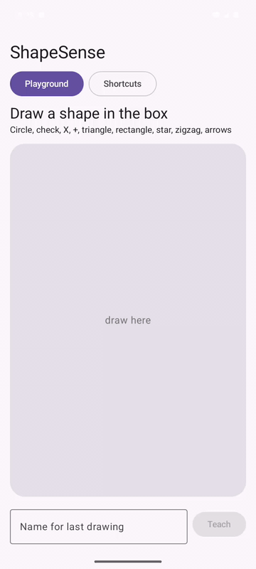
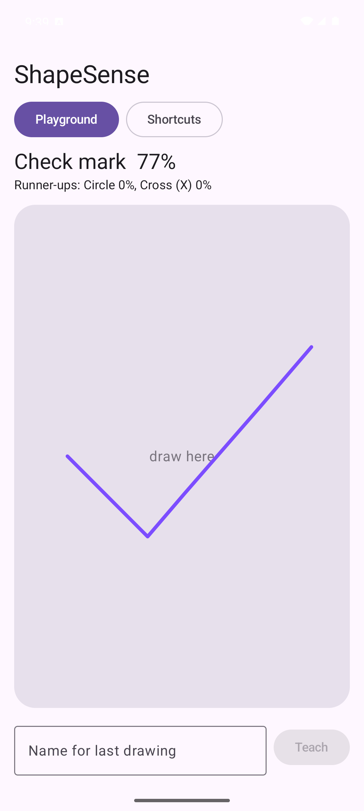
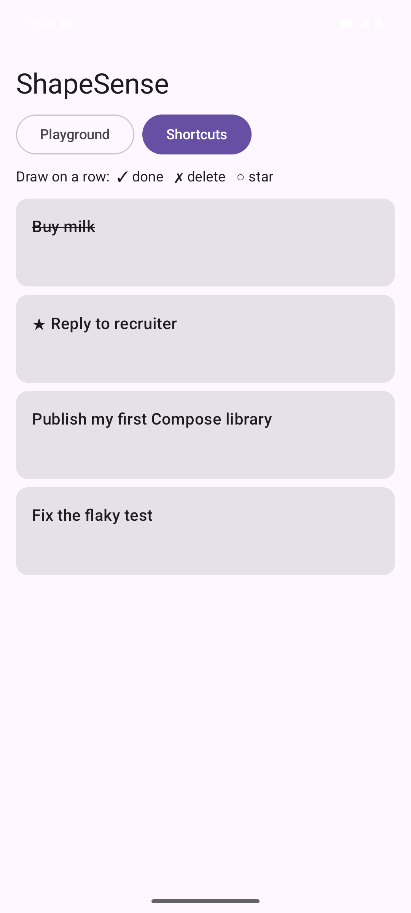

# ShapeSense

[](https://github.com/RaiyanShahid91/ShapeSense/actions/workflows/build.yml)
[](LICENSE)

**Draw-a-shape gestures for Jetpack Compose.** Let users draw a ✓, ✗, circle, star or arrow on any
composable, and react to it with one modifier.

## See it on a device

<p align="center">
  
  <br>
  <sub>Recorded from the sample app running on the Android emulator.</sub>
</p>

<table>
  <tr>
    <td align="center">
      
      <br>
      <sub>Playground: shows what each drawing was recognized as, with runner-ups, and lets you teach new shapes</sub>
    </td>
    <td align="center">
      
      <br>
      <sub>Shortcuts: draw a check to complete, an X to delete, or a circle to star a row</sub>
    </td>
  </tr>
</table>

Run the sample module in Android Studio to try it yourself.

```kotlin
Box(
    Modifier
        .fillMaxSize()
        .onShapeDrawn { result ->
            when (result.name) {
                Shapes.CHECK  -> markDone()
                Shapes.CROSS  -> delete()
                Shapes.CIRCLE -> favorite()
            }
        }
)
```

- **One modifier.** The user's finger trail is drawn and fades out for you.
- **No ML model, no network, no permissions.** A small point-cloud matcher (the
  [$P recognizer](https://depts.washington.edu/acelab/proj/dollar/pdollar.html)) runs in about
  10 ms on a desktop JVM.
- **Doesn't fight your UI.** Drawing is observed on the side, so clicks and scrolling underneath
  keep working (set `consumeEvents = true` if you want to take over).
- **Multi-stroke.** An "X" drawn as two lines works; stroke order and direction don't matter.
- **Teachable.** Users can record their own shapes at runtime.
- **Pure-Kotlin core.** `ShapeRecognizer` has no Android dependency and is easy to unit test.

## Built-in shapes

`CIRCLE` `CHECK` `CROSS` `PLUS` `TRIANGLE` `RECTANGLE` `STAR` `ZIGZAG` `ARROW_UP` `ARROW_DOWN`
`ARROW_LEFT` `ARROW_RIGHT`. Arrows are direction-sensitive. Shapes may be tilted up to about 12°.

## Usage

### Only react to some shapes

```kotlin
Modifier.onShapeDrawn(
    config = ShapeGestureConfig(
        allowedShapes = setOf(Shapes.CHECK, Shapes.CROSS),
        minScore = 0.6f,            // raise for destructive actions
    ),
) { result -> /* ... */ }
```

### Know when nothing matched

```kotlin
Modifier.onShapeDrawn(
    onUnrecognized = { gesture -> showHint("Closest was ${gesture.bestGuess?.name}") },
) { result -> /* ... */ }
```

### Teach it your own shape

```kotlin
var recognizer by remember { mutableStateOf(ShapeRecognizer.Default) }

// From any drawing the user made:
recognizer = recognizer + result.toTemplate("lightning")

// Or from coordinates:
recognizer = recognizer + ShapeTemplate.ofStrokes(
    "L", listOf(listOf(0f to 0f, 0f to 100f, 70f to 100f)),
)

Modifier.onShapeDrawn(recognizer = recognizer) { /* ... */ }
```

Teaching the same name several times makes it more reliable.

### Use the recognizer without Compose

```kotlin
val match = ShapeRecognizer().recognize(points, minScore = 0.55f)  // ShapeMatch("circle", 0.91f) or null
```

### Configuration

| `ShapeGestureConfig` | Default | Meaning |
|---|---|---|
| `minScore` | 0.55 | Minimum match (0..1) to accept a drawing |
| `minMargin` | 0 | Winner must beat the runner-up by this much |
| `idleTimeoutMillis` | 450 | Wait for another stroke after the finger lifts |
| `minStrokeLength` | 24 dp | Ignore taps and tiny jitters |
| `allowedShapes` | all | Restrict the candidates |
| `consumeEvents` | false | Block children from seeing the touches |
| `showTrail` / `trailColor` / `trailWidth` / `fadeOutMillis` | on / purple / 4 dp / 350 | Finger trail |

## Try it locally first

1. Open this folder in Android Studio (latest stable). Let Gradle sync.
2. Run the **sample** app on a device or emulator. *Playground* shows what each drawing was
   recognized as and lets you teach new shapes; *Shortcuts* is a to-do list you operate by drawing.
3. Run the library tests: `./gradlew :shapesense:testDebugUnitTest`
4. Try the library from another project before publishing anything:

   ```
   ./gradlew :shapesense:publishReleasePublicationToMavenLocal
   ```

   then in the other project add `mavenLocal()` to `repositories` and
   `implementation("com.brynflow:shapesense:0.1.0")`.

## How well does it work?

On 6,000 simulated hand-drawn gestures (random size, tilt, stretch, start point, direction, wobble
and overshoot) the top match is correct **98.8%** of the time, and 99.8% of scribbles, lines,
letters and spirals are rejected at the default `minScore`. Those numbers come from a simulator,
not real fingers, so treat them as a sanity check and tune `minScore` for your app.

## Known limitations

- Drawing on a scrollable list also scrolls it (observation only). Use `consumeEvents = true`
  where that matters, or restrict drawing to a non-scrolling area.
- Circles are the weakest built-in shape (about 91% on the simulator): a sloppy oval can look like a
  rounded rectangle. Drawing both in the same app works, but expect occasional mix-ups.
- Only the first finger is tracked.
- Letters and handwriting are out of scope; this recognizes simple geometric shapes and gestures.

## License

Apache License 2.0. See [LICENSE](LICENSE).
